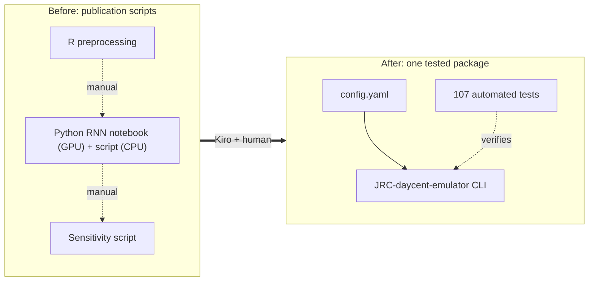
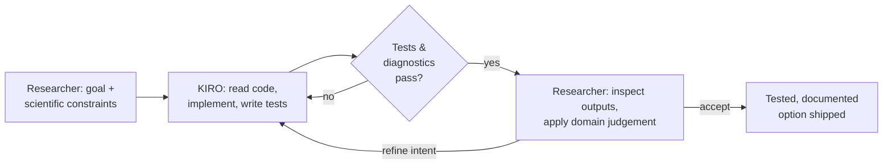
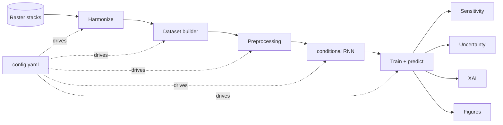
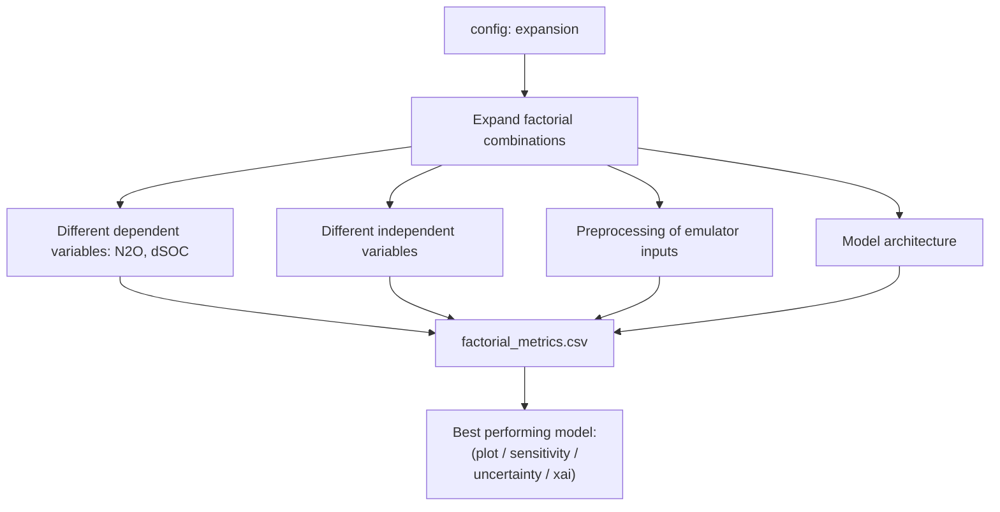
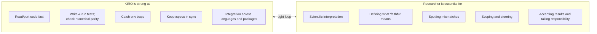

# Presentation flowcharts (Mermaid)

These are intentionally **simple**. Render them at <https://mermaid.live> (paste a
block, export PNG/SVG), or in VS Code / GitHub which render Mermaid natively.
Plain-text/ASCII versions of the same diagrams are in `figures_ascii.txt` for quick
drop-in or redrawing in PowerPoint.

---

## 01 — Before / After (why do this at all)

---

## 02 — The collaboration loop (the core message)

---

## 03 — What the agent built (the emulator pipeline)

---

## 04 — The factorial sweep (a human-scoped feature)

---

## 05 — Division of labour (who does what)

